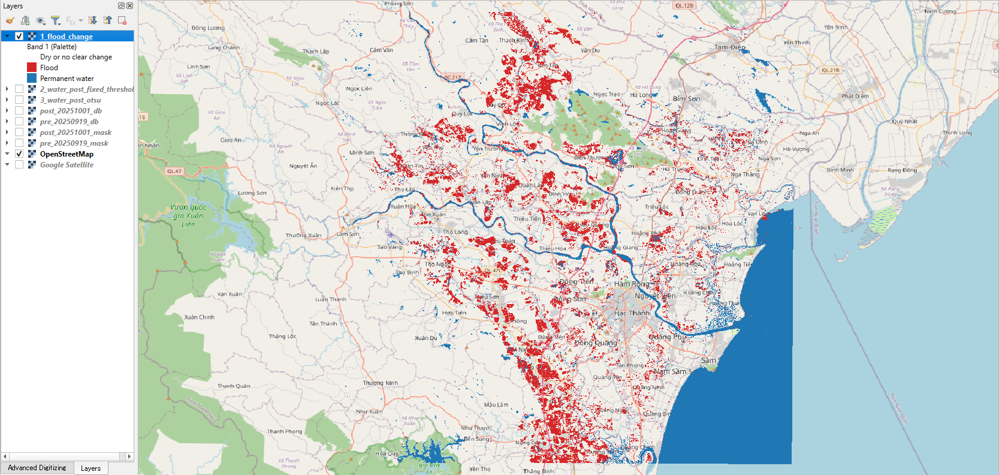
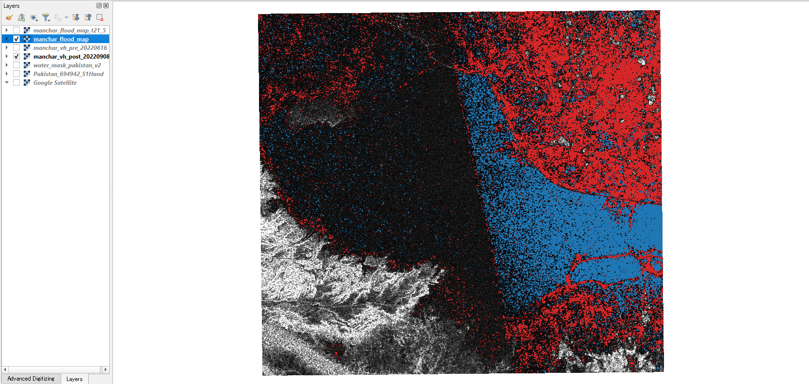

# sar-flood-detection-qgis

A QGIS Processing plugin that maps water and floods from Sentinel-1 radar images. It starts from the **raw Sentinel-1 GRD product as downloaded (`.SAFE.zip`)**: calibration, thermal noise removal, precise orbits, terrain correction with the Copernicus DEM, then speckle filtering, thresholds and pre/post-event change detection. It runs inside QGIS with no extra installs and no other software such as SNAP (only NumPy, SciPy and GDAL, which ship with QGIS).



*Flood map made entirely in QGIS from two raw Sentinel-1 zips (19 Sep and 1 Oct 2025), Thanh Hoa province, Vietnam: red = flood, blue = permanent water (rivers, reservoirs, sea). Base map © OpenStreetMap contributors. See [Example 3](#example-3-from-raw-products-to-a-flood-map-thanh-hoa-vietnam-2025).*

The default settings come from my companion project [sar-flood-unet](https://github.com/Ronnelpabalan/sar-flood-unet), where a 5×5 median filter followed by **VH < −23.3 dB** was the best simple threshold on the Sen1Floods11 training data (test IoU 0.592, against 0.675 for a U-Net).

## In plain words

Radar satellites such as Sentinel-1 can see the ground through clouds and at night, which matters during floods. Calm water reflects the radar signal away from the satellite, so it looks **dark** in the image. This plugin turns that into a map:

0. **Prepare the raw image** (optional, if you start from the downloaded product). Convert the stored numbers into backscatter, and put every pixel in its true place on the map. A radar image is recorded in the satellite's own geometry, so hills appear shifted towards the satellite; a DEM and the satellite's exact orbit are used to undo that.
1. **Clean the image.** Radar images are grainy ("speckle"). A small filter smooths each pixel with its neighbours.
2. **Pick a darkness limit** (the threshold). Pixels darker than it are called water.
3. **Compare two dates** (optional). If an area was dry before the flood and dark afterwards, it is marked as flooded; if it was dark on both dates, it is permanent water such as a lake or river.

The result is a raster you can overlay on the radar image or a base map, with water or flood drawn in colour and everything else transparent.

## Tools

The tools appear in the Processing Toolbox under **SAR Flood Detection**: *Preprocessing* holds the raw-product tool, *Flood mapping* the other two.

### Prepare Sentinel-1 GRD (from SAFE zip)

| Setting | Default | Notes |
|---|---|---|
| Sentinel-1 GRD product | — | The `.SAFE.zip` as downloaded, or the `manifest.safe` of an unzipped product. IW GRD (GRDH) products. |
| Area to process | — | Any extent; it is converted to longitude/latitude. Use **exactly the same extent** for both dates. |
| Polarisations | VV and VH | Or one of them. |
| Pixel size | 10 m | Output grid in UTM; the edges are rounded to whole pixels, so two dates processed with the same extent line up cell for cell. |
| Orbit | Precise orbit file | Downloaded from ESA's server and cached. If none is found, the orbit stored in the product is used, with a warning. |
| Folder for DEM tiles and orbit files | `~/.sar_flood_detection` | The tool keeps its downloads in the sub-folders `dem` and `orbits`, so each file is downloaded only once. |
| Download missing files | yes | Switch off to work offline; the tool then stops with a clear message if a DEM tile is missing (it never silently assumes flat ground). |
| Remove thermal noise | yes | |
| Output units | Decibels (dB) | Matches the default of the two flood tools. |

Outputs:

- **Backscatter** (sigma0), one band per polarisation (`Sigma0_VV_dB`, `Sigma0_VH_dB`), NaN = no data. It loads in QGIS as a grey VH image with a 2–98 % stretch.
- **Layover/shadow mask**: 1 = layover, 2 = shadow, 3 = both, 0 = seen normally (transparent), 255 = no data. Results under layover and shadow are not reliable.

What it does, step by step:

1. **Reads the zip directly** (no unzipping) and calibrates the 16-bit numbers to sigma0 with the product's calibration tables, after subtracting the thermal noise tables (range and azimuth).
2. **Orbit:** finds the precise orbit file (POEORB, or RESORB if no precise one exists yet) on [ESA's server](https://step.esa.int/auxdata/orbits/Sentinel-1/), the same source SNAP uses, and interpolates the satellite position.
3. **Heights:** downloads the needed [Copernicus GLO-30 DEM](https://registry.opendata.aws/copernicus-dem/) tiles (30 m) and adds the EGM2008 geoid that ships with QGIS, because the radar geometry needs heights above the WGS84 ellipsoid, not above sea level.
4. **Range-Doppler terrain correction**, the same model as SNAP's *Range-Doppler Terrain Correction*: for each map cell, find when the satellite looked at it (zero Doppler) and how far away it was (slant range); that gives the line and column in the radar image, which is resampled bilinearly. To save time, the exact solution is computed on a lattice (every 16 cells, at three heights) and interpolated in between.
5. **Layover and shadow** are found by comparing points that are seen in the same image lines, at least one DEM cell (30 m) apart.

A 60 km × 65 km area at 10 m (42 million cells, VV and VH) took about 2 minutes in QGIS on my laptop, with a peak of about 1.2 GB of memory for the arrays.

### Water map from one image

| Setting | Default | Notes |
|---|---|---|
| Band | 1 | Choose the VH band if the raster has VV and VH. |
| Input units | Decibels (dB) | Choose *Linear power* for products such as Planetary Computer RTC. |
| Speckle filter | Median, 5×5 | None, Median or Lee (Lee works in linear power, ENL 4.4). |
| Threshold method | Fixed | *Otsu* picks the threshold from the image's histogram and warns when the histogram has no clear water and land peaks. |
| Fixed threshold | −23.3 dB | Tuned for VH. VV usually needs a higher value. |

Output: 1 = water, 0 = not water, 255 = no data. The log reports the threshold used and the water percentage.

### Flood map from change detection (pre/post)

| Setting | Default | Notes |
|---|---|---|
| Pre-event / post-event raster and band | — | Both must be on the same pixel grid. If they are not, the tool stops and suggests *Raster → Align Rasters*. |
| Water threshold | −23.3 dB | Same rule as above, applied to both dates. |
| Minimum decrease | 3.0 dB | A pixel only counts as flood if it also got this much darker. |

Output: 1 = flood (water after, not before, and darker by at least the minimum decrease), 2 = permanent water (water on both dates), 0 = dry or no clear change, 255 = no data.

When QGIS loads a result, the background class is drawn transparent and the classes are named in the legend. The file itself also stores a colour table; GeoTIFF colour tables cannot hold transparency, so the background is white if the file is opened later without that styling.

## Example 1: one image (Sen1Floods11 chips)

I ran the water-map tool (VH, median 5×5) on three hand-labelled Sen1Floods11 chips and compared the masks with the hand labels. These are three chips, not a benchmark; the full evaluation is in sar-flood-unet.

| Chip | IoU, fixed −23.3 dB | IoU, Otsu | Otsu warning? |
|---|---|---|---|
| Pakistan_694942 | 0.293 | 0.268 | yes |
| Somalia_94102 | 0.299 | 0.115 | yes |
| Ghana_103272 | 0.573 | 0.469 | no |

On Pakistan_694942 almost all errors are false water: the mask covers 28.9% of the chip, the label 9.7%. Water and land overlap in VH here (median of labelled water −27.2 dB, darkest 10% of land below −26.3 dB), so no single threshold separates them well.

To see how much the threshold matters, I also swept it from −28 to −21 dB **using each chip's own label**. This is only possible because the chips are labelled, so it shows the best case, not something you can do on a new flood:

| Chip | Best threshold | IoU at best | IoU near −23.3 dB |
|---|---|---|---|
| Pakistan_694942 | −26.5 dB | 0.434 | 0.29 |
| Somalia_94102 | −23.0 dB | 0.301 | 0.30 |
| Ghana_103272 | −25.0 dB | 0.607 | 0.57 |

Each chip has a different best value, which is why −23.3 dB (chosen once on the whole training set) stays the default and why it should be checked locally.

## Example 2: change detection (2022 Pakistan floods, Manchar Lake)



**Data.** Two Sentinel-1A VH images from the same ascending track (relative orbit 42, about 13:36 UTC), clipped to 20 km × 20 km around Manchar Lake, Sindh, Pakistan, on a 10 m UTM grid (EPSG:32642):

- Pre-event: **2022-06-16**, before the monsoon floods
- Post-event: **2022-09-08**, during the floods

Settings: input in linear power, median 5×5, minimum decrease 3 dB. I ran the tool twice, with the default threshold and with −21.5 dB:

| Class | −23.3 dB (default) | −21.5 dB |
|---|---|---|
| Flood | 67.6 km² (16.9%) | 69.4 km² (17.3%) |
| Permanent water | 48.8 km² (12.2%) | 191.2 km² (47.8%) |
| Dry or no clear change | 283.6 km² (70.9%) | 139.4 km² (34.8%) |

What this shows:

- **The flood class barely changes** (+1.8 km²) because it also needs a 3 dB drop. In the north-east, where most flooding is mapped, the backscatter fell from about −19.2 to −23.9 dB (a 4.7 dB drop), a clear land-to-water change.
- **The permanent-water class depends strongly on the threshold.** A large dark area in the west, which a base map shows as water, sits at about −22.3 dB on both dates. With −23.3 dB it is classed as dry (97% of a sample box); with −21.5 dB, 73% of it becomes permanent water.
- **−21.5 dB is not simply better.** It also marks 23% of the north-eastern sample box as permanent water, i.e. fields that were already fairly dark in June. Without a reference map I cannot say how much of that is correct.

Neither run is validated: there is no reference flood map for this clip, so these are tool outputs and a sensitivity check, not accuracy figures.

## Example 3: from raw products to a flood map (Thanh Hoa, Vietnam, 2025)

This example uses only the plugin, from the downloaded zips to the flood map (the image at the top of this page).

**Event.** Flooding in Thanh Hoa province, north-central Vietnam, after Typhoon Bualoi in late September 2025.

**Data.** Two Sentinel-1A IW GRDH products (VV + VH) from the same descending track (relative orbit 91, about 22:51 UTC), used as downloaded:

- Pre-event: `S1A_IW_GRDH_1SDV_20250919T225130_20250919T225155_061063_079C29_568D` (**19 Sep 2025**)
- Post-event: `S1A_IW_GRDH_1SDV_20251001T225130_20251001T225155_061238_07A33D_495A` (**1 Oct 2025**)

**Steps in QGIS:**

1. *Prepare Sentinel-1 GRD* on each zip, area lon 105.4–106.0, lat 19.6–20.2, 10 m, VV and VH, precise orbit, dB. The tool downloaded the two precise orbit files itself and used four GLO-30 DEM tiles. Both outputs are on the same grid (6,310 × 6,667 cells, UTM 48N); 99.2 % of cells have data, layover 0.21 %, shadow 0.00 %.
2. *Flood map from change detection*: VH (band 2) of both dates, dB, median 5×5, water threshold −23.3 dB, minimum decrease 3 dB.
3. *Water map from one image* on the post-event VH, with the fixed threshold and with Otsu.

**Results** (valid area 4,173.8 km²):

| Class | Area | Share |
|---|---|---|
| Flood | 287.0 km² | 6.88 % |
| Permanent water (includes about 440 km² of sea) | 501.4 km² | 12.01 % |
| Dry or no clear change | 3,385.4 km² | 81.11 % |

On land only (sea removed where the DEM is 0 m; 3,736 km²): **flood 283.5 km²**, permanent water 84.6 km². With the same rule (VH, median 5×5, below −23.3 dB), water on land grew from **95.1 km² on 19 Sep to 380.9 km² on 1 Oct**. About 3.5 km² of "flood" falls on the sea (changes of the sea surface), and only 8 flood cells fall in layover or shadow.

Water map of the 1 Oct image alone: 802.6 km² (19.23 %) with −23.3 dB; Otsu chose −21.80 dB and gave 893.4 km² (21.40 %). Both include the sea.

What the map shows: flooding (red) lies in the low farmland beside the Mã and Chu rivers and over a large area in the south, with none on the hills in the west or on the limestone hills in the north; permanent water (blue) follows the rivers, the sea, the Bến En reservoir and coastal ponds. Many flood patches have straight edges that follow field blocks, which fits flooded rice fields; changes from field work (flooding or draining paddies) can look the same in radar. There is **no reference flood map for 1 Oct 2025**, so these areas are tool outputs, consistent with a river flood but not validated.

## How accurate is the preprocessing?

These are checks of the plugin's geometry against ESA's own data and between dates. Most were made while building the tool on two other products of the same track and area (Sentinel-1D, 21 Sep and 3 Oct 2026); the shift between dates was also measured on the 2025 pair above. They show the processing chain is consistent; they are not a check against surveyed ground points.

| Check | Result |
|---|---|
| Orbit stored in the product vs precise orbit file (the two 2026 products) | about 0.02 m apart, so the orbit choice made no difference for these products |
| Plugin's Range-Doppler model vs ESA's 210 geolocation grid points per product (the two 2026 products, heights 0–1,408 m) | at most 0.18 line and 0.10 column (under 2 m), mean −0.01 / −0.02; the same difference appears when ESA's own grid-point times are converted to lines, so it lies in ESA's table, not in the model. Times agree within 4.3 µs and distances within 8 mm. |
| Lattice interpolation vs solving every cell (1.26 million cells, real heights) | at most 0.002 column and 0.0002 line |
| Shift between the two dates (phase correlation, six 512 × 512 land patches) | at most 0.06 pixel (2026 pair and 2025 pair) |
| Coastline vs OpenStreetMap, checked by eye in QGIS | lines up |

## Limitations

- **One threshold does not fit every scene.** Wind, rain, shallow water and water with vegetation can make water brighter than −23.3 dB, and dry sand or bare soil can be as dark as water. Check the threshold against water you know (a river, a lake) with the Identify tool or the layer histogram, and adjust it.
- **The default is tuned for VH.** VV usually needs a higher (less negative) threshold.
- **Otsu needs both water and land in the image.** With little water or strongly overlapping classes it gives poor thresholds; the tool warns when the histogram has no clear valley, and in the examples above the fixed threshold did better.
- **Flooded vegetation and flooded urban areas are not detected.** They often get brighter rather than darker in radar.
- **Change detection needs matching images:** same orbit track, same polarisation and the same pixel grid, otherwise differences come from viewing geometry rather than the flood.
- **A "before" image must really be dry.** In a test with two 2026 images of Thanh Hoa, the earlier image had twice as much water on land as the later one, so change detection found almost no flood. Check the pre-event image first.
- **Flooded rice fields and farming changes look alike.** Paddies that are flooded or drained for cultivation change in the same way as floodwater.
- **Whole bands are read into memory.** The flood tools read whole rasters; clip large scenes to the area of interest. The preparation tool needs about 1.2 GB for a 60 × 65 km area at 10 m.
- **Preparation limits:** IW GRD products only (no SLC); the area must lie within one product (no mosaicking of neighbouring products); the output is sigma0 without radiometric terrain flattening, so slopes facing the satellite stay brighter than in RTC products such as Planetary Computer's. Noise removal can push very calm water down to the −50 dB floor; this does not affect thresholds around −23 dB.
- **Downloads.** The first run for a new area or date needs internet access to `step.esa.int` (orbits) and `copernicus-dem-30m.s3.amazonaws.com` (DEM); after that the files come from the data folder.
- **Experimental (version 0.2.0).** Tested on QGIS 3.40 on Windows.

## Installation

From a release zip: download the zip from the [Releases](https://github.com/Ronnelpabalan/sar-flood-detection-qgis/releases) page, then in QGIS use **Plugins → Manage and Install Plugins → Install from ZIP**. The tools then appear in the Processing Toolbox.

No extra Python packages are needed. The *Prepare Sentinel-1 GRD* tool needs internet access the first time it processes a new area or date (orbit files and DEM tiles); set the data folder to keep these files with your project.

From source: copy (or link) the `sar_flood_detection` folder into your QGIS profile's `python/plugins` folder, restart QGIS and enable *SAR Flood Detection* in the plugin manager.

## Tests

91 tests on synthetic data: calibration and noise removal, orbit files and interpolation, the Range-Doppler model, terrain correction and layover/shadow, filters, thresholds and change detection, plus 13 end-to-end tests that run the Processing tools. Most need GDAL, so run them with QGIS's Python. The full runs on real Sentinel-1 products were checked by hand (see the examples above). On Windows:

```bash
"C:\Program Files\QGIS 3.40.4\bin\python-qgis-ltr.bat" -m unittest discover -s tests -t . -v
```

## Repository layout

```
sar_flood_detection/          the plugin (copy this folder into QGIS)
  core/                       NumPy/SciPy only: calibration, annotation, orbit, geometry (Range-Doppler),
                              terrain (resampling, layover/shadow), filters, thresholds, change detection
  algorithms/                 the three Processing tools
  safe.py                     reading .SAFE.zip products
  orbit_files.py, dem.py      finding, downloading and caching orbit files, DEM tiles and the geoid
  terrain_correction.py       the terrain-correction chain
  raster_io.py                GDAL reading and writing
  provider.py, plugin.py      QGIS registration
tests/                        unit and end-to-end tests
docs/                         screenshots used in this README
```

## Data and credits

- **Sen1Floods11** hand-labelled chips (Bonafilia et al., 2020, CVPR Workshops), used for testing only and not included in this repository. The dataset's repository does not state a licence.
- **Sentinel-1 RTC** from [Microsoft Planetary Computer](https://planetarycomputer.microsoft.com/dataset/sentinel-1-rtc), licensed CC BY 4.0: contains modified Copernicus Sentinel data 2022; radiometric terrain correction by Catalyst. Scenes `S1A_IW_GRDH_1SDV_20220616T133605_20220616T133630_043689_053742_rtc` and `S1A_IW_GRDH_1SDV_20220908T133610_20220908T133635_044914_055D60_rtc`. Not included in this repository.
- **Sentinel-1 GRD products** for Example 3 and the accuracy checks: contains modified Copernicus Sentinel data 2025 and 2026, processed by ESA. Not included in this repository.
- **Sentinel-1 precise orbit files** from ESA's [STEP auxiliary data server](https://step.esa.int/auxdata/orbits/Sentinel-1/).
- **Copernicus DEM GLO-30**, downloaded by the plugin from the [AWS open data registry](https://registry.opendata.aws/copernicus-dem/): produced using Copernicus WorldDEM-30 © DLR e.V. 2010-2014 and © Airbus Defence and Space GmbH 2014-2018 provided under COPERNICUS by the European Union and ESA; all rights reserved.
- **EGM2008 geoid** (US National Geospatial-Intelligence Agency), from the PROJ data grid `us_nga_egm08_25.tif` that ships with QGIS.
- **Base map** in the Thanh Hoa screenshot: © OpenStreetMap contributors.
- The speckle filters are adapted from sar-flood-unet.

## Glossary

| Term | Meaning |
|---|---|
| SAR | Synthetic Aperture Radar: a satellite radar that images the ground day and night, through clouds. |
| Sentinel-1 | European Space Agency radar satellites (Copernicus programme); data is free. |
| VV, VH | Polarisations: VV sends and receives vertically; VH sends vertically and receives horizontally. VH usually separates water from land better. |
| Backscatter | How much radar signal returns to the satellite. Water returns little, so it looks dark. |
| dB | Decibels: a log scale for backscatter (10·log10 of linear power). Water is typically below about −20 dB in VH. |
| Linear power | Backscatter before conversion to dB. |
| RTC | Radiometric terrain correction: removes brightness changes caused by slopes. |
| GRD | Ground Range Detected: the standard Sentinel-1 product, with brightness only (no phase), delivered as a `.SAFE.zip`. |
| Sigma0 | Calibrated backscatter per unit of ground area, the usual quantity for flood mapping. |
| Thermal noise | The radar's own noise; it is subtracted so dark water is not brightened by it. |
| Precise orbit (POEORB) | The satellite's path computed by ESA about three weeks after the pass; restituted orbits (RESORB) are available within hours and are less exact. |
| DEM | Digital elevation model: a raster of ground heights. |
| Geoid | The sea-level surface; DEM heights are measured from it, satellite geometry from the WGS84 ellipsoid. |
| Range-Doppler terrain correction | Placing each radar pixel at its true map position, using the orbit, the radar timing and a DEM. |
| Layover / shadow | On steep slopes facing the radar, echoes from the top and the bottom arrive together (layover); slopes facing away can be hidden from the radar (shadow). |
| Speckle | Grainy noise in every radar image. |
| Median / Lee filter | Smoothing filters that reduce speckle. |
| ENL | Equivalent number of looks: how strong the speckle is; used by the Lee filter. |
| Threshold | Rule "water if backscatter is below X dB". |
| Otsu | Automatic method (Nobuyuki Otsu, 1979) that picks the threshold that best splits a histogram into two groups. |
| Change detection | Comparing images before and after an event to find what changed. |
| IoU | Intersection over union: overlap of mapped and true water divided by their combined area. 1 = perfect. |
| Processing Toolbox | The QGIS panel that lists analysis tools; tools there also work in the Graphical Modeler and in batch mode. |

## Licence

MIT. See [LICENSE](LICENSE).
