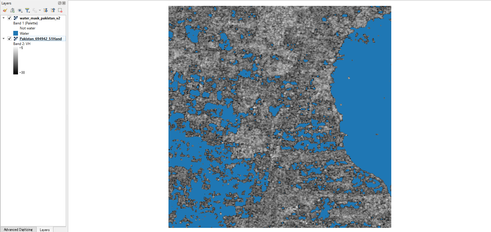

# sar-flood-detection-qgis

A QGIS Processing plugin that maps water and floods from Sentinel-1 radar images, using speckle filtering, thresholds and pre/post-event change detection. It runs inside QGIS with no extra installs (only NumPy, SciPy and GDAL, which ship with QGIS).



The default settings come from my companion project [sar-flood-unet](https://github.com/Ronnelpabalan/sar-flood-unet), where a 5×5 median filter followed by **VH < −23.3 dB** was the best simple threshold on the Sen1Floods11 training data (test IoU 0.592, against 0.675 for a U-Net).

## In plain words

Radar satellites such as Sentinel-1 can see the ground through clouds and at night, which matters during floods. Calm water reflects the radar signal away from the satellite, so it looks **dark** in the image. This plugin turns that into a map:

1. **Clean the image.** Radar images are grainy ("speckle"). A small filter smooths each pixel with its neighbours.
2. **Pick a darkness limit** (the threshold). Pixels darker than it are called water.
3. **Compare two dates** (optional). If an area was dry before the flood and dark afterwards, it is marked as flooded; if it was dark on both dates, it is permanent water such as a lake or river.

The result is a raster you can overlay on the radar image or a base map, with water or flood drawn in colour and everything else transparent.

## Tools

Both tools appear in the Processing Toolbox under **SAR Flood Detection → Flood mapping**.

### Water map from one image

| Setting | Default | Notes |
|---|---|---|
| Band | 1 | Choose the VH band if the raster has VV and VH. |
| Input units | Decibels (dB) | Choose *Linear power* for products such as Planetary Computer RTC. |
| Speckle filter | Median, 5×5 | None, Median or Lee (Lee works in linear power, ENL 4.4). |
| Threshold method | Fixed | *Otsu* picks the threshold from the image's histogram and warns when the histogram has no clear water and land peaks. |
| Fixed threshold | −23.3 dB | Tuned for VH. VV usually needs a higher value. |

Output: 1 = water, 0 = not water, 255 = no data. The log reports the threshold used and the water percentage.

### Flood map from change detection (pre/post)

| Setting | Default | Notes |
|---|---|---|
| Pre-event / post-event raster and band | — | Both must be on the same pixel grid. If they are not, the tool stops and suggests *Raster → Align Rasters*. |
| Water threshold | −23.3 dB | Same rule as above, applied to both dates. |
| Minimum decrease | 3.0 dB | A pixel only counts as flood if it also got this much darker. |

Output: 1 = flood (water after, not before, and darker by at least the minimum decrease), 2 = permanent water (water on both dates), 0 = dry or no clear change, 255 = no data.

When QGIS loads a result, the background class is drawn transparent and the classes are named in the legend. The file itself also stores a colour table; GeoTIFF colour tables cannot hold transparency, so the background is white if the file is opened later without that styling.

## Example 1: one image (Sen1Floods11 chips)

I ran the water-map tool (VH, median 5×5) on three hand-labelled Sen1Floods11 chips and compared the masks with the hand labels. These are three chips, not a benchmark; the full evaluation is in sar-flood-unet.

| Chip | IoU, fixed −23.3 dB | IoU, Otsu | Otsu warning? |
|---|---|---|---|
| Pakistan_694942 | 0.293 | 0.268 | yes |
| Somalia_94102 | 0.299 | 0.115 | yes |
| Ghana_103272 | 0.573 | 0.469 | no |

On Pakistan_694942 almost all errors are false water: the mask covers 28.9% of the chip, the label 9.7%. Water and land overlap in VH here (median of labelled water −27.2 dB, darkest 10% of land below −26.3 dB), so no single threshold separates them well.

To see how much the threshold matters, I also swept it from −28 to −21 dB **using each chip's own label**. This is only possible because the chips are labelled, so it shows the best case, not something you can do on a new flood:

| Chip | Best threshold | IoU at best | IoU near −23.3 dB |
|---|---|---|---|
| Pakistan_694942 | −26.5 dB | 0.434 | 0.29 |
| Somalia_94102 | −23.0 dB | 0.301 | 0.30 |
| Ghana_103272 | −25.0 dB | 0.607 | 0.57 |

Each chip has a different best value, which is why −23.3 dB (chosen once on the whole training set) stays the default and why it should be checked locally.

## Example 2: change detection (2022 Pakistan floods, Manchar Lake)


**Data.** Two Sentinel-1A VH images from the same ascending track (relative orbit 42, about 13:36 UTC), clipped to 20 km × 20 km around Manchar Lake, Sindh, Pakistan, on a 10 m UTM grid (EPSG:32642):

- Pre-event: **2022-06-16**, before the monsoon floods
- Post-event: **2022-09-08**, during the floods

Settings: input in linear power, median 5×5, minimum decrease 3 dB. I ran the tool twice, with the default threshold and with −21.5 dB:

| Class | −23.3 dB (default) | −21.5 dB |
|---|---|---|
| Flood | 67.6 km² (16.9%) | 69.4 km² (17.3%) |
| Permanent water | 48.8 km² (12.2%) | 191.2 km² (47.8%) |
| Dry or no clear change | 283.6 km² (70.9%) | 139.4 km² (34.8%) |

What this shows:

- **The flood class barely changes** (+1.8 km²) because it also needs a 3 dB drop. In the north-east, where most flooding is mapped, the backscatter fell from about −19.2 to −23.9 dB (a 4.7 dB drop), a clear land-to-water change.
- **The permanent-water class depends strongly on the threshold.** A large dark area in the west, which a base map shows as water, sits at about −22.3 dB on both dates. With −23.3 dB it is classed as dry (97% of a sample box); with −21.5 dB, 73% of it becomes permanent water.
- **−21.5 dB is not simply better.** It also marks 23% of the north-eastern sample box as permanent water, i.e. fields that were already fairly dark in June. Without a reference map I cannot say how much of that is correct.

Neither run is validated: there is no reference flood map for this clip, so these are tool outputs and a sensitivity check, not accuracy figures.

## Limitations

- **One threshold does not fit every scene.** Wind, rain, shallow water and water with vegetation can make water brighter than −23.3 dB, and dry sand or bare soil can be as dark as water. Check the threshold against water you know (a river, a lake) with the Identify tool or the layer histogram, and adjust it.
- **The default is tuned for VH.** VV usually needs a higher (less negative) threshold.
- **Otsu needs both water and land in the image.** With little water or strongly overlapping classes it gives poor thresholds; the tool warns when the histogram has no clear valley, and in the examples above the fixed threshold did better.
- **Flooded vegetation and flooded urban areas are not detected.** They often get brighter rather than darker in radar.
- **Change detection needs matching images:** same orbit track, same polarisation and the same pixel grid, otherwise differences come from viewing geometry rather than the flood.
- **Whole bands are read into memory.** Clip large scenes to the area of interest first.
- **Experimental (version 0.1.0).** Tested on QGIS 3.40 on Windows.

## Installation

From a release zip: download the zip from the [Releases](https://github.com/Ronnelpabalan/sar-flood-detection-qgis/releases) page, then in QGIS use **Plugins → Manage and Install Plugins → Install from ZIP**. The tools then appear in the Processing Toolbox.

From source: copy (or link) the `sar_flood_detection` folder into your QGIS profile's `python/plugins` folder, restart QGIS and enable *SAR Flood Detection* in the plugin manager.

## Tests

31 unit tests: the core functions (filters, thresholds, change detection) run with plain Python and NumPy/SciPy; 10 end-to-end tests run the Processing tools on synthetic rasters and need QGIS's Python. On Windows:

```bash
"C:\Program Files\QGIS 3.40.4\bin\python-qgis-ltr.bat" -m unittest discover -s tests -t . -v
```

## Repository layout

```
sar_flood_detection/          the plugin (copy this folder into QGIS)
  core/                       filters, thresholds, change detection (NumPy only)
  algorithms/                 the two Processing tools
  raster_io.py                GDAL reading and writing
  provider.py, plugin.py      QGIS registration
tests/                        unit and end-to-end tests
docs/                         screenshots used in this README
```

## Data and credits

- **Sen1Floods11** hand-labelled chips (Bonafilia et al., 2020, CVPR Workshops), used for testing only and not included in this repository. The dataset's repository does not state a licence.
- **Sentinel-1 RTC** from [Microsoft Planetary Computer](https://planetarycomputer.microsoft.com/dataset/sentinel-1-rtc), licensed CC BY 4.0: contains modified Copernicus Sentinel data 2022; radiometric terrain correction by Catalyst. Scenes `S1A_IW_GRDH_1SDV_20220616T133605_20220616T133630_043689_053742_rtc` and `S1A_IW_GRDH_1SDV_20220908T133610_20220908T133635_044914_055D60_rtc`. Not included in this repository.
- The speckle filters are adapted from sar-flood-unet.

## Glossary

| Term | Meaning |
|---|---|
| SAR | Synthetic Aperture Radar: a satellite radar that images the ground day and night, through clouds. |
| Sentinel-1 | European Space Agency radar satellites (Copernicus programme); data is free. |
| VV, VH | Polarisations: VV sends and receives vertically; VH sends vertically and receives horizontally. VH usually separates water from land better. |
| Backscatter | How much radar signal returns to the satellite. Water returns little, so it looks dark. |
| dB | Decibels: a log scale for backscatter (10·log10 of linear power). Water is typically below about −20 dB in VH. |
| Linear power | Backscatter before conversion to dB. |
| RTC | Radiometric terrain correction: removes brightness changes caused by slopes. |
| Speckle | Grainy noise in every radar image. |
| Median / Lee filter | Smoothing filters that reduce speckle. |
| ENL | Equivalent number of looks: how strong the speckle is; used by the Lee filter. |
| Threshold | Rule "water if backscatter is below X dB". |
| Otsu | Automatic method (Nobuyuki Otsu, 1979) that picks the threshold that best splits a histogram into two groups. |
| Change detection | Comparing images before and after an event to find what changed. |
| IoU | Intersection over union: overlap of mapped and true water divided by their combined area. 1 = perfect. |
| Processing Toolbox | The QGIS panel that lists analysis tools; tools there also work in the Graphical Modeler and in batch mode. |

## Licence

MIT. See [LICENSE](LICENSE).
